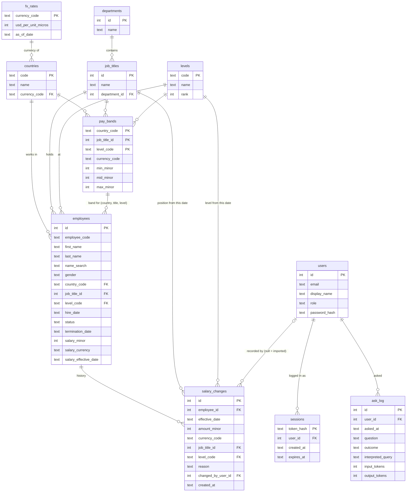

# 02 Data model and seed

Chat 2 output. Schema, money handling, salary history, users and roles, indexes, and the seed spec for 10,000 employees plus three demo users.
Inputs: `decisions.md` (D-002, D-006, D-012 to D-019), `01-requirements.md` (F1 to F8), `00-brief-analysis.md` (H2, H3, H6, H10).
A coding agent should be able to write the migration, the repositories and the seed script from this file alone.

## 1. Decisions this file settles

Proposed IDs; they are added to `decisions.md` at the end of Chat 3.

| ID | Decision | Why | Rejected alternatives |
| --- | --- | --- | --- |
| D-021 | Salary history is an append-only `salary_changes` table. `employees` also carries the current salary (`salary_minor`, `salary_currency`, `salary_effective_date`). The salary service writes the new history row and the current-salary columns in one transaction. A test checks that the current-salary columns equal the latest history row | Every list, filter, sort and insight reads one row per employee, with no "latest row per employee" subquery. History stays complete and auditable | Pure effective-dated table with "current" computed on read (every query carries a correlated subquery). Single current salary with no history (fails F4). A trigger keeps the copy in sync (hides logic from the TypeScript code and its tests) |
| D-022 | A new salary change needs: an effective date on or after the employee's current `salary_effective_date` and on or before today; an amount greater than 0; and the employee's country currency. Per reason: `merit` and `market_adjustment` raise the amount and keep the position; `promotion` raises the amount and moves to a higher level (and optionally a different title); `correction` changes the amount, the position, or both. A system reason `hire` is written for the first row and is never offered in the UI | History stays in date order, so the last row is always the current salary. Backdating before the current row would silently change past reports. Per-reason rules stop a "promotion" that promotes nobody | Allow any past date and recompute "current" (complex, makes reports unstable). Future-dated rows (already rejected in D-019). One generic rule for all reasons |
| D-023 | Money is annual gross base salary in integer minor units plus an ISO 4217 code. v1 allows only currencies with 2 decimal places. FX is stored as integer `usd_per_unit_micros` (USD per 1 unit of the currency, times 1,000,000). Conversion happens per employee, rounding half up to the cent, before aggregating | Integers avoid float drift. Per-employee conversion makes the USD median and the USD total come from the same numbers, and list totals equal report totals | REAL columns; decimal strings; converting aggregates instead of rows (median in USD would be impossible); JPY-style 0-decimal currencies (left out, no country needs them) |
| D-024 | Percentiles (P25, median, P75) are computed in the TypeScript insights service by linear interpolation, the same method as Excel's `PERCENTILE.INC` and `QUARTILE.INC` | HR is moving off Excel and can check our numbers against it. Percentile SQL functions are an optional extension, so we can't rely on them existing | SQL `percentile_cont` (extension, not guaranteed on every target); nearest-rank method (doesn't match Excel) |
| D-025 | The schema and queries use a portable SQLite subset: `STRICT` tables, `CHECK`, foreign keys, plain and composite indexes, `date()`. No `LAG`/`LEAD`, no aggregate `FILTER`, no `%` operator, no partial or expression indexes, no generated columns, no recursive CTEs. "Previous amount" in salary history is computed in TypeScript | Turso's rewritten engine lists these as unsupported, and Turso Cloud is moving to that engine. One subset means local SQLite, in-memory tests and production behave the same | Using full SQLite features and hoping production matches |
| D-026 | Seed dataset: 5 countries, 8 departments, 10 job titles, 5 levels, 250 pay bands. 10,000 active plus 250 terminated employees, with about 40,000 salary history rows. Four cohorts have a designed gender gap: two flagged, one just above the 5% line and one just below. The seed is generated deterministically from a fixed seed and a fixed reference date (2026-09-30), with Faker pinned to an exact version | Gives F2 to F8 something real to show: outside-band people, stale salaries, flagged and unflagged gaps, small groups Finance can't see. Deterministic, so tests and the demo can rely on exact numbers | Random seed each run; "10,000 rows including terminated"; uniform pay with no structure |
| D-027 | A role is a column on `users` with a `CHECK` constraint (`hr_admin`, `hr_viewer`, `finance`); permissions live in code and are tested per role. The seed creates the three demo users with passwords read from `DEMO_HR_ADMIN_PASSWORD`, `DEMO_HR_VIEWER_PASSWORD` and `DEMO_FINANCE_PASSWORD`, and exits with an error if any is missing or shorter than 12 characters | Three fixed roles don't need a roles table that suggests editable permissions we don't support. No password ever lives in the repo | Roles and permissions tables (implies a permissions editor); hardcoded demo passwords |
| D-028 | We store only the personal data the features need: name, gender, country, job, level, hire date, status, salary. No date of birth, address, personal email, phone or national ID | Salary data is sensitive (H10); every extra field is risk with no feature using it | Copying a typical HRIS employee record |
| D-029 | Each salary history row also records the position in effect from that date (`job_title_id`, `level_code`). Title and level change only through a salary change (`promotion` or `correction`), never through the plain employee edit form. Country is set at hire and not editable in v1 | HR can answer "when did she become Senior, and from what level?" from the history alone, and the employee's current position and pay can never drift apart | Position not recorded (a promotion row can't say from what to what). A separate position-history table (two histories to keep in step). Title and level editable on the employee form (position changes with no record) |

Amendments proposed (logged at the end of Chat 3):
- **A-001**: D-019's reason list gains `hire`, which the system writes only for the first salary row. The UI still offers the four reasons from D-019.
- **A-002**: D-019's salary change also records the position (D-029). This changes two acceptance criteria in `01-requirements.md`: F3 "edit employee" no longer edits title, level or country, and F4 history shows the level and title before and after each change.

## 2. ER diagram



Department is not stored on `employees`; it comes from the job title. Each title belongs to one department in v1.

## 3. DDL draft

Target schema. Chat 3 picks the migration tool; if that tool can't express `STRICT` or a `CHECK`, the migration is written as raw SQL rather than dropping the constraint.

Conventions:
- Dates are `TEXT` `YYYY-MM-DD`, checked with `date(x) IS x`.
- Timestamps are `TEXT` ISO 8601 UTC (`2026-10-10T09:15:00.000Z`), always set by the application from an injected clock. There is no `DEFAULT CURRENT_TIMESTAMP`, so tests stay deterministic.
- IDs are `INTEGER PRIMARY KEY`. The seed sets them explicitly.
- The db module runs `PRAGMA foreign_keys = ON` on every connection (enforcement is off by default in both SQLite and Turso). An integration test proves a foreign-key violation is rejected.

```sql
CREATE TABLE fx_rates (
  currency_code       TEXT    PRIMARY KEY CHECK (length(currency_code) = 3 AND currency_code = upper(currency_code)),
  usd_per_unit_micros INTEGER NOT NULL CHECK (usd_per_unit_micros > 0),
  as_of_date          TEXT    NOT NULL CHECK (date(as_of_date) IS as_of_date)
) STRICT;

CREATE TABLE countries (
  code          TEXT PRIMARY KEY CHECK (length(code) = 2 AND code = upper(code)),  -- ISO 3166-1 alpha-2
  name          TEXT NOT NULL UNIQUE,
  currency_code TEXT NOT NULL REFERENCES fx_rates(currency_code)
) STRICT;

CREATE TABLE departments (
  id   INTEGER PRIMARY KEY,
  name TEXT    NOT NULL UNIQUE
) STRICT;

CREATE TABLE job_titles (
  id            INTEGER PRIMARY KEY,
  name          TEXT    NOT NULL UNIQUE,
  department_id INTEGER NOT NULL REFERENCES departments(id)
) STRICT;

CREATE TABLE levels (
  code TEXT    PRIMARY KEY CHECK (code IN ('L1','L2','L3','L4','L5')),
  name TEXT    NOT NULL UNIQUE,
  rank INTEGER NOT NULL UNIQUE
) STRICT;

CREATE TABLE pay_bands (
  country_code  TEXT    NOT NULL REFERENCES countries(code),
  job_title_id  INTEGER NOT NULL REFERENCES job_titles(id),
  level_code    TEXT    NOT NULL REFERENCES levels(code),
  currency_code TEXT    NOT NULL REFERENCES fx_rates(currency_code),
  min_minor     INTEGER NOT NULL CHECK (min_minor > 0),
  mid_minor     INTEGER NOT NULL,
  max_minor     INTEGER NOT NULL,
  PRIMARY KEY (country_code, job_title_id, level_code),
  CHECK (min_minor < mid_minor AND mid_minor < max_minor)
) STRICT;

CREATE TABLE users (
  id            INTEGER PRIMARY KEY,
  email         TEXT    NOT NULL UNIQUE CHECK (email = lower(email)),
  display_name  TEXT    NOT NULL,
  role          TEXT    NOT NULL CHECK (role IN ('hr_admin','hr_viewer','finance')),
  password_hash TEXT    NOT NULL,          -- PHC-format string; algorithm chosen in Chat 3
  created_at    TEXT    NOT NULL
) STRICT;

CREATE TABLE employees (
  id                    INTEGER PRIMARY KEY,
  employee_code         TEXT    NOT NULL UNIQUE CHECK (employee_code GLOB 'E[0-9][0-9][0-9][0-9][0-9][0-9]'),
  first_name            TEXT    NOT NULL CHECK (length(trim(first_name)) BETWEEN 1 AND 100),
  last_name             TEXT    NOT NULL CHECK (length(trim(last_name))  BETWEEN 1 AND 100),
  name_search           TEXT    NOT NULL,  -- normalised "first last", written by the app, see section 5
  gender                TEXT    NOT NULL CHECK (gender IN ('female','male','non_binary','not_disclosed')),
  country_code          TEXT    NOT NULL REFERENCES countries(code),
  job_title_id          INTEGER NOT NULL REFERENCES job_titles(id),
  level_code            TEXT    NOT NULL REFERENCES levels(code),
  hire_date             TEXT    NOT NULL CHECK (date(hire_date) IS hire_date),
  status                TEXT    NOT NULL CHECK (status IN ('active','terminated')),
  termination_date      TEXT    CHECK (termination_date IS NULL OR date(termination_date) IS termination_date),
  salary_minor          INTEGER NOT NULL CHECK (salary_minor > 0),
  salary_currency       TEXT    NOT NULL REFERENCES fx_rates(currency_code),
  salary_effective_date TEXT    NOT NULL CHECK (date(salary_effective_date) IS salary_effective_date),
  created_at            TEXT    NOT NULL,
  updated_at            TEXT    NOT NULL,
  FOREIGN KEY (country_code, job_title_id, level_code)
    REFERENCES pay_bands(country_code, job_title_id, level_code),  -- every employee has a band
  CHECK ((status = 'terminated') = (termination_date IS NOT NULL)),
  CHECK (termination_date IS NULL OR termination_date >= hire_date),
  CHECK (salary_effective_date >= hire_date)
) STRICT;

CREATE TABLE salary_changes (
  id                 INTEGER PRIMARY KEY,
  employee_id        INTEGER NOT NULL REFERENCES employees(id),
  effective_date     TEXT    NOT NULL CHECK (date(effective_date) IS effective_date),
  amount_minor       INTEGER NOT NULL CHECK (amount_minor > 0),
  currency_code      TEXT    NOT NULL REFERENCES fx_rates(currency_code),
  job_title_id       INTEGER NOT NULL REFERENCES job_titles(id),  -- position in effect from effective_date (D-029)
  level_code         TEXT    NOT NULL REFERENCES levels(code),
  reason             TEXT    NOT NULL CHECK (reason IN ('hire','promotion','merit','market_adjustment','correction')),
  changed_by_user_id INTEGER REFERENCES users(id),  -- NULL means imported by the seed; the UI shows "Imported"
  created_at         TEXT    NOT NULL
) STRICT;

-- Added by Chat 3 (ADR 0006): server-side sessions. The cookie holds a random token; only its SHA-256 is stored.
CREATE TABLE sessions (
  token_hash TEXT    PRIMARY KEY,                    -- hex SHA-256 of the 32-byte random token
  user_id    INTEGER NOT NULL REFERENCES users(id),
  created_at TEXT    NOT NULL,
  expires_at TEXT    NOT NULL
) STRICT;

-- Added by Chat 3 (ADR 0008): one row per "Ask about pay" request. Serves the daily caps and the audit trail.
CREATE TABLE ask_log (
  id                INTEGER PRIMARY KEY,
  user_id           INTEGER NOT NULL REFERENCES users(id),
  asked_at          TEXT    NOT NULL,
  question          TEXT    NOT NULL CHECK (length(question) BETWEEN 1 AND 500),
  outcome           TEXT    NOT NULL CHECK (outcome IN ('answered','cannot_answer','error','rate_limited')),
  interpreted_query TEXT,                            -- JSON of the structured query; NULL unless answered
  input_tokens      INTEGER,
  output_tokens     INTEGER
) STRICT;
```

No table is ever hard-deleted from in normal use (D-016). The only bulk delete is the seed's reset (section 7.10).

## 4. Money and FX rules

| Rule | Detail |
| --- | --- |
| Unit | Annual gross base salary. No monthly or hourly figures in v1 |
| Storage | `amount_minor INTEGER` plus `currency_code TEXT`. A money value never travels without its currency, in the DB, the API or the UI |
| Allowed currencies | Those in `fx_rates`. v1 seeds USD, EUR, GBP, CAD, INR, all with 2 decimal places |
| Employee currency | Must equal the employee's country currency in v1 (service rule; the column exists so a later version can allow e.g. USD-paid staff abroad) |
| FX representation | `usd_per_unit_micros`: USD per 1 unit of the currency times 1,000,000. Example: GBP at 1.34 USD is `1340000` |
| Conversion | `usdMinor = Math.round(amountMinor * usdPerUnitMicros / 1_000_000)` for positive amounts (half up to the cent). In SQL, when needed for sorting: `(e.salary_minor * f.usd_per_unit_micros + 500000) / 1000000` (integer division gives the same result for positive values). A unit test asserts the TypeScript and SQL forms agree |
| Overflow | Largest seeded value is about INR 1.5 crore (1.5e9 minor) times 11,500 = 1.7e13, well below `Number.MAX_SAFE_INTEGER` (9.0e15). No BigInt needed |
| Aggregation | Convert each employee to USD first, then sum, average or take percentiles. Per-country figures in local currency are aggregated in local currency without conversion |
| Averages | Computed in minor units and rounded half up to the cent for display |
| Percentiles | Linear interpolation (D-024): for sorted values `x[0..n-1]` and `p` in [0,1], `h = (n-1)p`, result `x[floor(h)] + (h - floor(h)) * (x[floor(h)+1] - x[floor(h)])`, then rounded to the cent |
| Compa-ratio | `salary_minor / mid_minor` of the employee's band, same currency, shown to 2 decimals |
| Outside band | `salary_minor < min_minor` (below) or `salary_minor > max_minor` (above). Equal to min or max is inside |
| Gender gap % | Within a cohort, in local currency: `(meanMale - meanFemale) / meanMale * 100`. Flag when the unrounded value is 5 or more (D-013). Displayed to 1 decimal. Org-wide mean and median gaps use USD values. Positive means women are paid less |
| Display | The UI formats with `Intl.NumberFormat` and the currency code. Every USD figure converted from another currency shows "FX as of 2026-09-30" |

FX table (illustrative demo rates, fixed for reproducibility, not market data):

| Currency | USD per unit | `usd_per_unit_micros` | `as_of_date` |
| --- | --- | --- | --- |
| USD | 1.000000 | 1000000 | 2026-09-30 |
| EUR | 1.160000 | 1160000 | 2026-09-30 |
| GBP | 1.340000 | 1340000 | 2026-09-30 |
| CAD | 0.720000 | 720000 | 2026-09-30 |
| INR | 0.011500 | 11500 | 2026-09-30 |

## 5. Business rules and where each is enforced

| Rule | DB | Service (tested) |
| --- | --- | --- |
| Valid enums (gender, status, role, reason, level) | `CHECK` | zod schema returns a 400 with a field message first |
| Every employee has a pay band for their country, title and level | Composite FK | Returns 422 "no pay band for this combination" before insert |
| Terminated means a termination date exists, and vice versa | `CHECK` | Terminate sets both; termination date >= hire date and <= today |
| Current salary and position on `employees` equal the latest history row (amount, currency, effective date, title, level) | Not expressible | Salary service writes both in one transaction; invariant test over the seeded DB |
| Salary change date rule and per-reason rules (D-022) | Not expressible | Salary service; 422 with a specific message per rule: `merit`/`market_adjustment` need amount > current and the same position; `promotion` needs amount > current and new level rank > current rank; `correction` needs the amount or the position to differ |
| Title and level change only through a salary change (D-029) | Not expressible | The employee edit endpoint's schema has no title, level or country fields; a test proves sending them is rejected with 400 |
| The new position has a pay band | Composite FK on `employees` | Checked before the transaction; 422 "no pay band for this combination" |
| First history row has reason `hire` and effective date = hire date | Not expressible | Employee creation writes it; seed test checks every employee |
| Employee code is unique and sequential | `UNIQUE`, `GLOB` | New code = `E` + zero-padded (max id + 1), inside the insert transaction |
| `name_search` | `NOT NULL` | Set on every insert and name edit: `"first last"`, Unicode NFKD, diacritics removed, lower-cased, spaces collapsed. Search input is normalised the same way. "muller" finds "Müller" |
| Terminated employees excluded from current insights | n/a | Every insights query filters `status = 'active'` |
| Finance minimum group size of 5 (D-012) | n/a | Insights service, after aggregation |

## 6. Indexes, each tied to the query it serves

At 10,000 rows SQLite can scan the whole employees table in a few milliseconds, so indexes here are about avoiding a sort step on the paged list and keeping joins direct. Chat 8 measures each list and insights query with and without these indexes and records the numbers in `docs/performance.md`.

| # | Index | Query it serves |
| --- | --- | --- |
| I1 | `employees(employee_code)` UNIQUE (implicit) | Search by employee ID. A query matching `^E\d+$` uses a range: `employee_code >= ? AND employee_code < ?` (prefix), not `LIKE` |
| I2 | `CREATE INDEX ix_employees_status_name ON employees(status, last_name, first_name, id)` | Default list: active employees sorted by name, page of 50. The index walk returns rows in order, so there is no sort step; `id` makes the order stable for paging |
| I3 | `CREATE INDEX ix_employees_cohort ON employees(country_code, job_title_id, level_code, status)` | Insights grouped by country, title, level; gender equity per cohort; pay band join; list filter by country (leading column) |
| I4 | `CREATE INDEX ix_employees_title_level ON employees(job_title_id, level_code)` | List filter by job title, or by department (department resolves to `job_title_id IN (...)`) |
| I5 | `CREATE INDEX ix_employees_salary_date ON employees(salary_effective_date)` | Filter "no salary change since <date>" and the stale-salary insight |
| I6 | `CREATE INDEX ix_employees_hire_date ON employees(hire_date)` | List sorted by hire date |
| I7 | `CREATE INDEX ix_salary_changes_employee ON salary_changes(employee_id, effective_date, id)` | Salary history on the detail page (in order); reading the latest row when recording a change |
| I8 | `users(email)` UNIQUE (implicit) | Login lookup |
| I9 | `pay_bands` primary key | Band lookup for compa-ratio and outside-band, and the employees composite FK |
| I10 | `job_titles(name)`, `departments(name)`, `countries(name)` UNIQUE (implicit) | Filter dropdowns and integrity |
| I11 | `sessions` primary key `token_hash` | Session lookup on every authenticated request |
| I12 | `CREATE INDEX ix_sessions_user ON sessions(user_id)` | Logout-everywhere and the FK check when a user row changes |
| I13 | `CREATE INDEX ix_ask_log_user_time ON ask_log(user_id, asked_at)` | Per-user daily cap: count of today's questions for one user |
| I14 | `CREATE INDEX ix_ask_log_time ON ask_log(asked_at)` | Global daily cap: count of today's questions for everyone |

Deliberately not indexed:
- **Name search** (`name_search LIKE '%term%'`): a leading wildcard can't use a B-tree index. A 10k-row scan is expected to be a few ms; Chat 8 confirms.
- **Sort by salary in USD**: an expression over a join, which can't be indexed in the portable subset (D-025). Expected cost is a 10k-row sort. Fallback if Chat 8 measures it above budget: store `salary_usd_minor` on `employees`, written with the current salary (FX is static).
- **Gender**: four values, low selectivity, always combined with other filters.
- **`salary_changes(changed_by_user_id)`**: nothing queries by it.

## 7. Seed spec

### 7.1 Shape of the code

- `generateDataset(config, seed, refDate) -> Dataset`: a pure function, no DB, no clock, no env. All the rules below live here and are unit-tested directly.
- `writeDataset(db, dataset, users)`: resets and inserts in one write transaction, in chunks of 500 rows per multi-row `INSERT` (employees have 17 columns, so 8,500 bound parameters per statement, under SQLite's 32,766 limit).
- `seed` CLI: reads env, validates demo passwords, hashes them, calls both, prints the summary report (7.11).
- Target: under 10 s locally, including password hashing.

### 7.2 Determinism

- One constant `SEED = 20261011` and `REF_DATE = 2026-09-30`. The seed never reads the real clock.
- One Faker instance per country locale (section 7.3), each seeded with `SEED + countryIndex`, plus a locale-free numeric generator seeded with `SEED` for all draws that are not names.
- `faker.setDefaultRefDate(REF_DATE)` on every instance.
- Faker is pinned to an exact version in `package.json` (no `^`), because generated values can change between Faker releases.
- Generation iterates in a fixed order: countries, then titles, then levels (all sorted by code or id).
- Counts are allocated first, then people generated (7.5), so cohort sizes never depend on random draws.
- Employee codes: after generation, active employees are shuffled with the seeded generator and numbered `E000001` to `E010000`; terminated ones get `E010001` to `E010250`. The code reveals nothing about the cohort.
- Normal draws use Box-Muller in a small pure function that takes the uniform generator as a parameter (testable).

### 7.3 Reference data

Countries and headcount (active):

| Code | Country | Currency | Faker locale | Active headcount | Pay level vs US (in USD) |
| --- | --- | --- | --- | --- | --- |
| IN | India | INR | `en_IN` | 4,000 | 0.16 |
| US | United States | USD | `en_US` | 2,500 | 1.00 |
| GB | United Kingdom | GBP | `en_GB` | 1,500 | 0.72 |
| DE | Germany | EUR | `de` | 1,200 | 0.75 |
| CA | Canada | CAD | `en_CA` | 800 | 0.78 |
| | **Total** | | | **10,000** | |

Departments and job titles (each title belongs to one department):

| Department | Job title | Share of headcount | L1 midpoint, US (USD) | Women share (before level factor) |
| --- | --- | --- | --- | --- |
| Engineering | Software Engineer | 28% | 95,000 | 28% |
| Engineering | Data Analyst | 7% | 75,000 | 28% |
| Product | Product Manager | 4% | 100,000 | 45% |
| Product | Product Designer | 4% | 80,000 | 45% |
| Sales | Account Executive | 15% | 65,000 | 40% |
| Marketing | Marketing Specialist | 7% | 60,000 | 55% |
| Finance | Accountant | 5% | 62,000 | 50% |
| People | HR Generalist | 4% | 58,000 | 70% |
| Operations | Operations Analyst | 10% | 52,000 | 40% |
| Customer Support | Support Specialist | 16% | 45,000 | 55% |

Levels:

| Code | Name | Rank | Share of headcount | Midpoint multiplier | Women share factor |
| --- | --- | --- | --- | --- | --- |
| L1 | Associate | 1 | 25% | 1.00 | 1.15 |
| L2 | Intermediate | 2 | 30% | 1.25 | 1.05 |
| L3 | Senior | 3 | 25% | 1.55 | 1.00 |
| L4 | Lead | 4 | 13% | 1.90 | 0.85 |
| L5 | Principal | 5 | 7% | 2.30 | 0.70 |

"Senior Engineer in India" in the persona questions means country IN, title Software Engineer, level L3.

### 7.4 Pay bands (250 rows: 5 countries x 10 titles x 5 levels)

- `midUSD = L1 midpoint (US) x level multiplier x country pay level`
- `midLocal = midUSD / USD per unit`, rounded to the nearest 1,000 major units (nearest 10,000 for INR)
- `min = round(0.80 x mid)`, `max = round(1.20 x mid)`, same rounding step
- Stored in minor units with the country currency.

Worked example: India, Software Engineer, L3: 95,000 x 1.55 x 0.16 = 23,560 USD, divided by 0.0115 = INR 2,048,696, rounded to INR 2,050,000 (20.5 lakh). Band INR 1,640,000 to 2,460,000.

These figures are invented and plausible, not market data. The README says so.

### 7.5 Allocating active employees to cohorts

1. For each country, cohort count = `country headcount x title share x level share`, rounded with the largest-remainder method so each country's cohorts sum exactly to its headcount.
2. Within each cohort, gender counts use the largest-remainder method on these probabilities: non-binary 1%, not disclosed 2%, female `0.97 x w`, male `0.97 x (1 - w)`, where `w = min(0.90, title women share x level factor)`.
3. Names: female and male employees get `person.firstName('female')` / `('male')` from their country's locale; non-binary and not-disclosed employees get `person.firstName()`. Last names come from `person.lastName()`.

Effect by design: women are a smaller share of Engineering and of senior levels, so the org-wide gap is clearly positive even though most like-for-like cohorts show almost no gap. This is the demo moment for why D-013 compares cohorts, not just the org-wide figure.

### 7.6 Current salary

1. Each active employee draws a compa-ratio from a normal distribution, mean 1.00, standard deviation 0.06, clipped to [0.84, 1.16].
2. Gender gap shaping, for every cohort with at least 5 women and 5 men: scale women's salaries by one factor so that the realised gap equals the cohort's target. Targets:

   | Cohort (country / title / level) | Target gap | Expected flag |
   | --- | --- | --- |
   | IN / Software Engineer / L3 | 8.0% | Flagged |
   | US / Account Executive / L2 | 6.0% | Flagged |
   | GB / Software Engineer / L4 | 5.3% | Flagged (just above the line) |
   | DE / Software Engineer / L2 | 4.7% | Not flagged (just below the line) |
   | Every other eligible cohort | uniform in [-2.0%, +2.0%] | Not flagged |

   The four named cohorts are all well above 5 women and 5 men under 7.5. Rounding (step 4) can move a realised gap by a few hundredths of a point; targets sit at least 0.3 points from the line so the flag result can't change.
3. Outliers: 3% of active employees outside the four gap cohorts get a compa-ratio redrawn uniformly in [0.65, 0.76] (below band), and another 3% in [1.25, 1.40] (above band). Chosen with the seeded generator. These ranges are far enough from 0.80 and 1.20 that the ±2% gap shaping in step 2 can't move them back inside the band. Steps 2 and 3 are applied in that order: shape first, then outliers, only on cohorts with a target of ±2%, and the shaping factor is recomputed after outliers so the realised gap still matches. Some women in the 8% cohort will also fall below band; that is realistic and expected.
4. `salary = compa x band mid`, rounded to the nearest 100 major units (nearest 1,000 for INR).

### 7.7 Salary history

Built backwards from the current salary, so the last row always equals it.

- **Hire date**: tenure drawn from 30% under 2 years, 35% 2 to 5 years, 25% 5 to 9 years, 10% 9 to 13 years before `REF_DATE`, then a uniform day within the bucket. Earliest possible hire date 2013-10-01.
- **Review cycle**: 1 April each year. An employee is eligible from the first 1 April at least 6 months after hire, up to 2026-04-01.
- **Per eligible cycle**: merit raise with probability 0.85, increase uniform in 2.0% to 6.0% (to 0.1%).
- **Promotion**: employees at L2 or above with 2+ years of tenure get one promotion with probability 0.6, at a random eligible cycle, replacing that cycle's merit, increase 10% to 15%. Every row before the promotion carries the level one rank lower (L3 before means L2); rows from the promotion on carry the current level. Title stays the same throughout. All other rows carry the employee's current title and level.
- **Market adjustment**: 5% of employees get one in 2025 (on a random day between 2025-06-01 and 2025-12-31), increase 5% to 10%.
- **Correction**: 1% of employees get a correction 14 days after one of their raises (only if on or before `REF_DATE`), change uniform in -3% to +3% with absolute value at least 0.5%.
- **Stale salaries**: 10% of active employees with at least 2.5 years of tenure are marked stale and get no rows after 2024-09-29. Combined with people who simply missed reviews, expect about 10% to 12% of active employees with no change since 2024-09-30.
- **Hire row**: reason `hire`, effective date = hire date.
- **Backwards calculation**: starting from the current salary, each earlier amount = later amount / (1 + change), rounded as in 7.6 step 4. Effective dates strictly increase within an employee.
- **Audit fields**: `changed_by_user_id = NULL` (shown as "Imported"), `created_at = effective_date + 'T00:00:00.000Z'`.
- **Expected volume**: about 4 rows per employee, about 40,000 rows in total. The exact count goes in the seed report.

### 7.8 Terminated employees

- 250, spread across countries in proportion to headcount, then titles and levels drawn by the shares in 7.3.
- Termination date uniform between 2024-01-01 and 2026-09-15, hire date at least 6 months earlier.
- Same salary and history rules, with the termination date standing in for `REF_DATE`. They take no part in gap shaping and outlier selection.

### 7.9 Demo users

| Email | Display name | Role | Password env var |
| --- | --- | --- | --- |
| `hr.admin@acme.test` | HR Admin (demo) | `hr_admin` | `DEMO_HR_ADMIN_PASSWORD` |
| `hr.viewer@acme.test` | HR Viewer (demo) | `hr_viewer` | `DEMO_HR_VIEWER_PASSWORD` |
| `finance@acme.test` | Finance (demo) | `finance` | `DEMO_FINANCE_PASSWORD` |

- `.test` is a reserved domain, so these addresses can never reach a real inbox.
- The seed exits with a clear message if any variable is missing or shorter than 12 characters. `.env.example` lists the names with empty values.
- Tests never run the seed for users. They create users through test-data builders with test-only passwords.

### 7.10 Idempotency and reset

- Running the seed twice gives identical domain data.
- One write transaction does three things in order:
  1. Deletes all rows from `salary_changes`, `employees`, `pay_bands`, `job_titles`, `departments`, `levels`, `countries` and `fx_rates`, in that order.
  2. Inserts the dataset.
  3. Upserts the three users by email, so their passwords follow the current env values.
- The reset also deletes all rows from `ask_log` and `sessions` first (so every reviewer is logged out and caps restart).
- The same command is the candidate for restoring the live demo to a known state. Chat 8 decides on that.
- Cost on Turso: about 52,000 rows written per reset (deletes count as writes too, so a reset roughly doubles that) against the free plan's 10 million rows written per month. Chat 8 owns that budget.

### 7.11 Seed report (printed to the console)

- Active and terminated counts, overall and per country.
- History row count.
- Outside-band count, below and above.
- Count with no salary change since 2024-09-30.
- The four target cohorts with their realised gaps and flags.
- Eligible cohorts (at least 5 women and 5 men) out of 250.
- Org-wide mean and median gender gap in USD.
- Groups with fewer than 5 people (for the Finance rule).

### 7.12 Seed tests (input to Chat 5's test list)

All run against `generateDataset` in memory unless noted:
1. Same seed gives a deep-equal dataset; a hash of the ordered rows matches a recorded value.
2. Exactly 10,000 active and 250 terminated; per-country active counts match 7.3.
3. Every employee has a band; every band has min < mid < max.
4. Every employee's history starts with a `hire` row on the hire date, has strictly increasing dates, ends on or before `REF_DATE` (or termination date), and its last row equals the current salary, title and level. The level changes only on a `promotion` row, and only upward by one rank.
5. The four target cohorts land within 0.1 points of target and flag as expected; every other eligible cohort has an absolute gap under 2.5%.
6. Outside-band share is between 5% and 8%; stale share between 9% and 13%.
7. `toUsdMinor` rounding cases, and agreement between the TypeScript and SQL conversion forms (integration test).
8. The seed CLI refuses to run when a demo password env var is missing or too short.
9. Integration: after `writeDataset` on an in-memory DB, current-salary columns equal the latest history row for every employee, and `PRAGMA foreign_keys` is on.

## 8. Acceptance criteria for this file

- [ ] ER diagram (Mermaid) covers every table in the DDL.
- [ ] DDL draft has types, keys, foreign keys and `CHECK` constraints for every enum and date.
- [ ] Money, FX, rounding, percentile, compa-ratio, outside-band and gender-gap formulas are written out precisely enough to unit-test.
- [ ] Every index is tied to a named query; deliberately missing indexes say why.
- [ ] Seed distribution tables fully specify countries, titles, levels, bands, gender mix, gap cohorts, outliers, history and terminated employees.
- [ ] Demo passwords come only from env vars; the seed fails without them.
- [ ] Seed determinism rules are explicit (seed, reference date, pinned Faker, allocate-then-generate).
- [ ] Only the portable SQL subset of D-025 is used.

## 9. Out of scope for this data model, and why

- **Country transfers.** Moving an employee to another country changes currency, band and tax context; v1 sets country at hire only. HR would terminate and re-hire, or this becomes a later feature.
- **Lateral title changes with no pay change.** Recorded as a `correction` in v1; a dedicated "transfer" reason is a later addition.
- **Bonuses, equity, allowances, pay frequency other than annual.** Base salary answers the brief's questions (01, out of scope).
- **Editable FX rates and pay bands.** Static and seeded (D-017, D-018).
- **Optimistic locking for concurrent edits.** One HR Admin edits at a time in v1; `updated_at` exists, so a version check can be added later.
- **Audit trail for non-salary edits** (name, title, level). Salary history is audited (D-019); a general audit log is a later feature.
- **Managers and reporting lines, cost centres, locations within a country.** No v1 question needs them.
- **Currencies without 2 decimal places.** No seeded country uses one; supporting them means storing the exponent per currency.

## 10. Open questions

| # | Question | Default if not answered | Owner |
| --- | --- | --- | --- |
| 1 | Resolved 9 Oct: promotions record the old and new level (D-029). 10,000 active plus 250 terminated (D-026). Illustrative FX rates, labelled as such (section 4) | - | Hashir |
| 4 | Resolved by Chat 3: migrations are hand-written SQL files (ADR 0003) | - | - |
| 5 | Resolved by Chat 3: scrypt hashing, sessions in the DB (ADR 0006) | - | - |
| 6 | Is the seed command also the demo reset mechanism, and how often does it run? | Candidate only | Chat 8 |
| 7 | Does salary-in-USD sorting stay within the F2 budget without a stored USD column? | Expected yes; measured | Chat 8 |

## Sources

- Turso SQLite compatibility matrix (STRICT, CHECK, foreign keys, window function and expression gaps, percentile as an extension): https://github.com/tursodatabase/turso/blob/main/COMPAT.md
- Turso CREATE TABLE reference (foreign key enforcement off by default, needs `PRAGMA foreign_keys = ON`): https://docs.turso.tech/sql-reference/statements/create-table
- Turso pricing, free plan rows-written and storage limits: https://turso.tech/pricing
- Turso platform roadmap (new server implementation using the same protocols as libSQL): https://turso.tech/blog/upcoming-changes-to-the-turso-platform-and-roadmap
- Faker API (`seed`, `setDefaultRefDate`, per-locale instances): https://fakerjs.dev/api/faker
- Faker usage guide (relative dates need a fixed reference date for reproducibility): https://v8.fakerjs.dev/guide/usage
