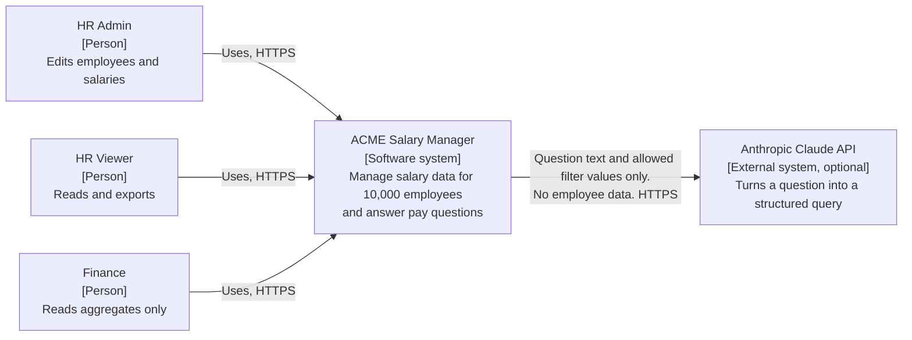
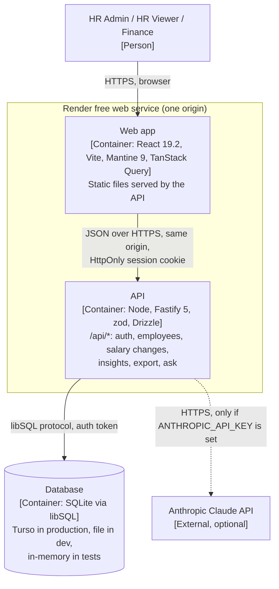

# 03 Architecture and stack

Chat 3 output. Libraries and structure within the decided TypeScript stack (D-001), recorded as ADRs in `adr/`.
Inputs: `decisions.md`, `01-requirements.md`, `02-data-model.md`, `chat-plan.md` (starting hypothesis).
A coding agent should be able to scaffold the repo, place every file, and wire every dependency from this file and the ADRs alone.
Updated in Chat 7 to match decisions logged after Chat 3 (D-038 as amended by A-005, D-040, D-042, D-043, D-045, D-049, D-055, D-063, D-064 to D-068). No new decisions.

## 1. Summary

One TypeScript monorepo. One deployable: a Fastify API that also serves the built React app, so the browser only ever talks to one origin. SQLite through libSQL, with Drizzle as a typed query builder over hand-written SQL migrations. Business rules live in a pure `domain` folder with no I/O. "Ask about pay" uses Claude Haiku with strict tool use to fill a structured query. Our own code runs that query and writes the answer sentence, so the model never sees salary data or produces numbers.

## 2. The starting hypothesis, challenged

| Hypothesis in `chat-plan.md` | Verdict | Why |
| --- | --- | --- |
| TypeScript monorepo | Keep | API and web share zod schemas and money helpers (D-001). npm workspaces; no Turborepo or Nx, since three packages don't need a build orchestrator |
| Express or Fastify, with zod | **Fastify 5** | Built-in `app.inject()` tests HTTP without opening a port, routes are typed from zod schemas through `fastify-type-provider-zod`, and logging (pino) and plugin encapsulation for role guards are built in. Express 5 would need each of these assembled by hand (ADR 0005) |
| libSQL client: local file, in-memory, Turso | **Keep, confirms D-006** | `@libsql/client` supports `file:`, `:memory:` and remote URLs, interactive transactions and batches (ADR 0003) |
| Drizzle or Kysely | **Drizzle, as a query builder only** | First-party libSQL support and types inferred from one schema file. The Kysely libSQL dialect is a small single-maintainer package. Drizzle's docs don't show `STRICT` tables, so migrations are plain SQL files and the Drizzle schema mirrors them, guarded by a drift test (ADR 0003) |
| React with Vite | Keep | Standard, fast dev server, no SSR needed for an internal tool |
| Mantine or shadcn/ui | **Mantine 9** | Data-dense admin UI with tables, forms, date pickers and charts in one coherent library, with no component code copied into the repo (ADR 0007) |
| TanStack Query and Table | **Query yes, Table no** | Paging, sorting and filtering all happen on the server (H3), so a client table engine has nothing to do. A Mantine `Table` plus our own pager is enough |
| Recharts | **Keep, via `@mantine/charts`** | Mantine's chart package is built on Recharts 3, so we get matching styles with no second setup |
| Vitest everywhere; 1 or 2 Playwright smoke tests | Keep | Vitest 5 (D-055) for unit, integration and component tests; one Playwright smoke test. Chat 5 owns the details |
| Separate free static site plus API service (D-005) | **Amend: one service** | Two origins means CORS plus either cross-site cookies or tokens held in JavaScript. Render's static-site rewrites are documented to accept a full URL as the destination, but not to forward POST bodies or cookies (ADR 0002) |

## 3. C4 level 1: system context



## 4. C4 level 2: containers



Inside the API, a request flows one way: **route** (validate with zod, check permission) to **service** (rules, transactions, role-based shaping of the result) to **repository** (Drizzle queries) to the **database**. Services call **domain** functions (pure: money, percentiles, pay equity, salary-change rules, permissions), and receive a **clock** and an **interpreter** as injected dependencies. Nothing below the route layer knows about HTTP. Nothing in `domain` knows about the database.

## 5. Folder tree

```
acme-salary/
  package.json                 npm workspaces; root scripts: dev, build, test, test:coverage, lint, typecheck, seed, e2e, eval
  CLAUDE.md                    Claude Code project instructions (D-067)
  .claude/                     Claude Code kit: settings.json, hooks/, skills/tdd-slice/, agents/spec-reviewer.md (D-064 to D-068)
  .husky/                      pre-commit (lint-staged), commit-msg (commitlint, then scripts/check-commit-shape.mjs) (D-059)
  scripts/
    check-commit-shape.mjs     red commits carry tests, green commits carry none (A-006)
  .nvmrc                       current Node LTS, pinned at S0
  .env.example                 every env var from section 8, empty values
  .gitignore                   includes .ai-notes/ (D-007), *.db, .env
  tsconfig.base.json           strict, noUncheckedIndexedAccess, verbatimModuleSyntax
  vitest.config.ts             Vitest projects: shared, api, web
  README.md
  docs/                        00 to 08 and performance.md (from the Project)
    adr/                       0001 to 0008
    evals/                     committed Ask eval reports (D-053)
  packages/
    shared/                    used by api and web; no runtime dependencies besides zod
      src/
        schemas/               zod: employee, salary-change, list-query, structured-query, problem
        money.ts               formatMoney, toUsdMinor (pure, unit-tested)
        percent.ts             changePct, gapPct, sharePct, compaRatio (D-070, 04 section 8.4.1)
        index.ts
  apps/
    api/
      src/
        main.ts                reads config, opens db, runs migrations, buildApp, listen
        app.ts                 buildApp(deps): the composition root used by main.ts and every test
        config.ts              zod-validated env; exits with a clear message if invalid
        domain/                pure functions only, no imports from db/ or http/
          money.ts             conversion and rounding (D-023)
          percentiles.ts       PERCENTILE.INC (D-024)
          pay-query.ts         aggregatePay: the one aggregation engine for insights and Ask, minimum group size applied inside (D-040)
          pay-equity.ts        cohort gap, flag, minimum group size (D-013)
          compa.ts             band position (below, inside, above); compa-ratio comes from compaRatio in packages/shared/src/percent.ts
          salary-rules.ts      D-022 and D-029 checks, returning typed rule violations
          permissions.ts       role to allowed actions table (D-002, D-012)
          clock.ts             Clock interface; systemClock and fixedClock
        db/
          client.ts            createDb(url, authToken): libSQL client, PRAGMA foreign_keys = ON, Drizzle instance
          schema.ts            Drizzle tables mirroring the SQL migrations
          migrate.ts           applies migrations/*.sql in order, records them in schema_migrations
          migrations/
            0001_init.sql      the DDL from 02-data-model.md
        http/
          problem.ts           RFC 9457 problem details builder and AppError types
          error-handler.ts     maps AppError, zod errors and unknown errors to problem+json
          auth-plugin.ts       reads the session cookie, loads the user, decorates request.user
          require.ts           requires(action) onRequest hook using domain/permissions (D-043)
        modules/
          auth/                routes.ts  service.ts  session-repo.ts  password.ts
          employees/           routes.ts  service.ts  repo.ts  csv.ts
          salary/              routes.ts  service.ts  repo.ts
          insights/            routes.ts  service.ts  repo.ts
          reference/           routes.ts  repo.ts      (countries, titles, levels, bands, FX as-of)
          ask/                 routes.ts  service.ts  interpreter.ts  anthropic-interpreter.ts  ask-log-repo.ts
        seed/
          generate.ts          generateDataset (pure, 02 section 7.1)
          random.ts            seeded uniform, normal, shuffle, largest-remainder
          write.ts             writeDataset
          cli.ts               npm run seed
      test/
        setup.ts               replaces fetch with a stub that throws (D-051)
        builders/              test-data builders: anEmployee(), aSalaryChange(), aUser(role)
        helpers.ts             testApp(): in-memory db, migrations, fixedClock, FakeInterpreter, loggedInAs(role)
      evals/
        ask-eval.json          15 questions with expected structured queries (D-053)
    web/
      index.html
      vite.config.ts           dev proxy /api to the API port
      src/
        main.tsx               MantineProvider, QueryClientProvider, Router
        api/client.ts          fetch wrapper: same-origin, credentials, problem+json to typed errors
        features/
          auth/                LoginPage, useSession
          employees/           EmployeeListPage, EmployeeDetailPage, EmployeeForm, useEmployeeFilters (URL)
          salary/              SalaryChangeForm, SalaryHistory
          insights/            InsightsPage, PayEquityPage
          ask/                 AskPage (hidden when me.askEnabled is false)
        components/            Money, FxAsOf, EmptyState, ErrorState, Pager, RoleGate, ServerStatusBanner (D-045)
      test/
        setup.ts               Mantine mocks, MSW server, render wrapper (05 section 3.1)
        fixtures/              MSW fixture builders, each parsed with the shared schema (D-049, D-050)
  e2e/
    smoke.spec.ts              Playwright: log in, filter, record a raise, see it in history
```

Test files sit next to the code they test as `*.test.ts(x)`. Integration tests for routes live beside each module's `routes.ts` as `routes.test.ts`.

## 6. Key design rules (for the coding agent)

1. **Composition root, no container.** `buildApp({ db, clock, interpreter, config })` wires everything. Tests pass an in-memory db, a `fixedClock` and a `FakeInterpreter`. No DI framework, no module-level singletons that read env.
2. **Domain is pure.** `domain/` imports nothing from `db/`, `http/`, `modules/` or Node I/O. Every rule in 02 sections 4 and 5 that isn't a DB constraint is a domain function with unit tests.
3. **Permissions are data.** `domain/permissions.ts` exports one table of `role -> actions`. Routes declare `onRequest: requires('salary.write')`, so the role check runs before body validation and a forbidden role never sees a 400 (D-043). A test iterates the route table and the role table so every endpoint is checked for every role (D-002).
4. **Finance shaping happens in the aggregation engine, not the UI.** `domain/pay-query.ts` (`aggregatePay`) serves both insights and Ask, and for a Finance user drops every group under 5 people before anything is returned (D-012, D-040). The UI never receives data it must hide.
5. **One validation source.** zod schemas in `packages/shared` validate API input (via the Fastify type provider), web forms (via a zod resolver) and URL filters. The web app never redefines a rule the API enforces.
6. **Errors are problem details.** Every non-2xx response is `application/problem+json` with `type`, `title`, `status`, `detail`, a stable machine-readable `code` (for example `SALARY_DATE_BEFORE_CURRENT`), and for validation an `errors` array of `{ path, message }`. Status codes: 400 validation, 401 not logged in, 403 role not allowed, 404 not found, 415 non-JSON body on a write (`UNSUPPORTED_MEDIA_TYPE`), 422 business rule, 429 rate or cap limit, 503 "Ask about pay" unavailable, 500 unexpected (no stack trace in the body). Checks run in the order 401, 403, 415, 400, 404, 422 (D-043).
7. **Transactions in services.** A service that writes more than one row (salary change plus current-salary columns, employee plus hire row) does it in one `write` transaction. Interactive libSQL transactions lock writes and time out after 5 seconds, so no network call (including the LLM) ever runs inside one.
8. **Time comes from the clock.** No `new Date()` outside `domain/clock.ts`. "Today" for D-022 is the clock's date in UTC.
9. **Money stays integer.** Amounts cross every boundary (DB, service, JSON, props) as `{ amountMinor: number, currency: string }`. Formatting happens only in the web app's `Money` component.
10. **Logs never contain salary values or names.** The pino redaction list covers the cookie header, `password`, and any field ending in `Minor`.

## 7. Authentication and sessions (ADR 0006)

- `POST /api/auth/login` with email and password. On success the API creates a 32-byte random token, stores its SHA-256 in `sessions` with an expiry 8 hours ahead, and sets cookie `sid`: `HttpOnly`, `SameSite=Lax`, `Path=/`, `Secure` in production, `Max-Age=28800`.
- Every `/api/*` route except login and health resolves the cookie to a user (one primary-key lookup). Expired or unknown token: 401.
- `POST /api/auth/logout` deletes the row and clears the cookie. `GET /api/auth/me` returns the user and role, which the web app uses to choose the landing page.
- CSRF: the cookie is same-site and `Lax`, and every write endpoint accepts only `application/json` bodies, which a cross-site form cannot send without a CORS preflight that we never approve.
- Login is rate-limited (`@fastify/rate-limit`, 10 attempts per minute per IP). Wrong email and wrong password return the same 401 message.
- Passwords are hashed with Node's built-in `crypto.scrypt`. Parameters are read from config: the production default is N=2^15, r=8, p=3 (one of OWASP's equivalent scrypt settings, chosen for its 32 MiB memory cost on a small instance); tests use N=2^10 to stay fast, and one test asserts the production default (05 section 5.2). 16-byte random salt, stored as `scrypt$32768$8$3$<salt base64>$<hash base64>`, compared with `timingSafeEqual`.

## 8. Configuration and secrets

All env vars are read once, in `config.ts`, and validated with zod. The process exits at startup with a list of what's wrong.

| Variable | Required | Default | Notes |
| --- | --- | --- | --- |
| `NODE_ENV` | no | `development` | `production` turns on the `Secure` cookie flag and static file serving |
| `PORT` | no | `3000` | Render sets it |
| `DATABASE_URL` | yes | | `file:./data/dev.db` locally; `libsql://<db>.turso.io` in production; tests use `:memory:` directly |
| `DATABASE_AUTH_TOKEN` | in production | | Turso token; never logged |
| `ASK_PROVIDER` | no | `gemini` | `gemini` or `anthropic` (ADR 0009) |
| `GEMINI_API_KEY` | no | | Key for `ASK_PROVIDER=gemini`. Absent: "Ask about pay" is off (D-004) |
| `ANTHROPIC_API_KEY` | no | | Key for `ASK_PROVIDER=anthropic`; absent: Ask is off. Belongs to a dedicated Console workspace (ADR 0008) |
| `ASK_MODEL` | no | `gemini-flash-latest` (Gemini), `claude-haiku-5-5` (Anthropic) | |
| `ASK_USER_DAILY_LIMIT` | no | `30` | Questions per user per UTC day |
| `ASK_GLOBAL_DAILY_LIMIT` | no | `300` | Questions per UTC day across all users |
| `DEMO_HR_ADMIN_PASSWORD`, `DEMO_HR_VIEWER_PASSWORD`, `DEMO_FINANCE_PASSWORD` | seed only | | 02 section 7.9; the API itself never reads them |
| `LOG_LEVEL` | no | `info` | |

Secrets live in Render's environment settings and a local `.env` that is git-ignored. `.env.example` lists every name with an empty value.

## 9. "Ask about pay" design (ADR 0008)

1. Web sends `POST /api/ask` with `{ question }` (1 to 500 characters).
2. Service checks the key exists (else 503 `ASK_UNAVAILABLE`), then the per-user and global daily caps from `ask_log` (else 429 `ASK_LIMIT_REACHED`).
3. The interpreter calls Claude (`claude-haiku-5-5`, `max_tokens` 512, 15-second timeout, no retries in the request path) with:
   - a system prompt describing the supported metrics and today's date;
   - two tools, both `strict: true`: `run_pay_query` (the structured query from D-015) and `cannot_answer` (a reason plus one suggested question);
   - `tool_choice: { type: "any" }`, so the reply is always one of the two tools;
   - the allowed values for every filter (countries, departments, titles, levels, genders) as enums in the tool schema.

   The model receives no employee rows, names or salaries.
4. The tool input is parsed again with the shared zod schema (defence in depth; enum values are matched case-insensitively, since the docs note the model may change capitalisation).
5. The insights service runs the query **as the logged-in user**: the same permission and Finance minimum-group rules as the insights screens.
6. Our code writes the answer sentence from a template (for example "Median salary for Software Engineer, L3 Senior, India: INR 20,40,000 (USD 23,460, FX as of 2026-09-30), 280 employees"). The response returns `{ answer, interpretedQuery, rows }`, and the UI shows the interpreted query beside the answer (D-003).
7. One `ask_log` row is written per request, with outcome and token counts.

Why this shape: the model's only job is language to structure, which strict tool use constrains to valid output. Numbers come from tested code, so a wrong answer can only mean a wrong interpretation, and that is visible on screen. In tests, `FakeInterpreter` maps fixed questions to fixed queries, so the suite never calls the network. The eval set (Chat 5) runs the real interpreter separately.

## 10. Deployment shape (confirmed in Chat 8)

- One Render free web service. Build: `npm ci && npm run build` (Vite builds `apps/web/dist`; `tsc -b` builds `packages/shared` and `apps/api`). Start: `node apps/api/dist/main.js`.
- On startup the API runs pending migrations (idempotent), then serves `/api/*` and the static web build, with an SPA fallback to `index.html` for client routes.
- `GET /api/health` returns 200 when the database answers `SELECT 1`.
- Turso free database for persistence (D-005). Render free instances spin down after 15 minutes without traffic and take about a minute to start, showing Render's own loading page meanwhile. That page covers the first visit, so the web app needs no waking state there. A tab left open past the 15-minute idle window does: its next API call hits a sleeping instance, and the web app shows `ServerStatusBanner` and retries GETs once the server answers (D-045, 04 section 8.3). The README warns about the first load and Chat 8 decides on keeping it warm. Render's 750 free instance hours a month cover one always-on service.

## 11. Acceptance criteria for this file

- [ ] C4 context and container diagrams (Mermaid) show every container, external system and protocol.
- [ ] Folder tree places every module named in 01 and 02, and the seed, tests and e2e.
- [ ] Every library choice names the alternative rejected and why, here or in an ADR.
- [ ] Session vs JWT, Express vs Fastify, Drizzle vs Kysely, Mantine vs shadcn/ui, and LLM provider, key handling and spend cap are each decided.
- [ ] D-006 confirmed; D-005 amendment proposed with reasons.
- [ ] Error format, config and layering rules are concrete enough to implement without guessing.
- [ ] 8 ADRs in `adr/`, with ADR 0001 recording D-001.

## 12. Out of scope, and why

- **Microservices, queues, caches (Redis).** One process handles 10,000 rows comfortably; Chat 8 measures it.
- **SSO and OAuth.** Rejected in D-002; demo accounts only.
- **JWT and refresh tokens.** Nothing here needs stateless auth (ADR 0006).
- **Server-side rendering or Next.js.** An internal tool behind a login has no SEO need, and SSR would complicate the single-origin static serving.
- **Streaming LLM responses.** One short tool call; nothing to stream.
- **An API versioning scheme (`/v1`).** The only client ships in the same deploy. Add a version prefix if a second client ever appears.
- **OpenAPI generation.** The shared zod schemas are the contract between our two clients. `@fastify/swagger` can generate a document later from the same schemas.

## 13. Open questions

| # | Question | Default | Owner |
| --- | --- | --- | --- |
| 1 | Keep the free instance warm (scheduled ping), or accept the cold start and warn in the README? | Decide with real cold-start numbers | Chat 8 |
| 2 | Which Render and Turso regions, to keep database round trips short? | Render: `singapore` (D-063). Turso: the closest region, picked at S0 | S0, Chat 8 |
| 3 | ~~Exact structured-query JSON schema within the strict-tool limits~~ | Resolved: D-042, 04 section 7.2 | Chat 4 |
| 4 | ~~Component tests: mock the API with MSW, or test hooks against a fake client?~~ | Resolved: MSW (D-049) | Chat 5 |
| 5 | Turso Cloud is moving to its rewritten engine. Does our SQL subset (D-025) run unchanged on the live database? | A smoke test against the deployed database in S9 | Chat 8 |

## Sources

- Render free tier (spin-down after 15 minutes, about one minute to start, 750 instance hours, no persistent disk): https://render.com/docs/free
- Render static site redirects and rewrites (destination may be a full URL; no mention of forwarding POST bodies or cookies): https://render.com/docs/redirects-rewrites
- libSQL TypeScript client reference (`:memory:` and `file:` URLs, `transaction("write")`, 5-second interactive transaction lock, batch modes): https://docs.turso.tech/sdk/ts/reference
- Turso SQLite compatibility (basis for D-025): https://github.com/tursodatabase/turso/blob/main/COMPAT.md
- Express vs Fastify 2026 (both on 5.x; Fastify's built-in schema validation and typed routes): https://www.pkgpulse.com/guides/express-vs-fastify-2026
- fastify-type-provider-zod (v7 supports Zod 4.2+): https://cdn.jsdelivr.net/npm/fastify-type-provider-zod@7.0.0/README.md
- kysely-libsql package (one collaborator, low download count): https://www.npmjs.com/package/kysely-libsql
- Drizzle vs Kysely trade-offs (schema-inferred types vs hand-maintained interfaces): https://www.pkgpulse.com/guides/drizzle-orm-v1-vs-prisma-6-vs-kysely-2026
- Mantine 9.0 (requires React 19.2+, `@mantine/charts` on Recharts 3): https://alpha.mantine.dev/changelog/9-0-0
- Mantine 9.1 (April 2026, charts and dates packages): https://mantine.dev/changelog/9-1-0
- Vitest 5.0 announcement (replaces the Vitest 4 source; D-055): https://vitest.dev/blog/vitest-5
- OWASP Password Storage Cheat Sheet (scrypt parameters and equivalents): https://cheatsheetseries.owasp.org/cheatsheets/Password_Storage_Cheat_Sheet.html
- Claude models overview (Haiku 5.5 as the fastest model, API ID `claude-haiku-5-5`): https://platform.claude.com/docs/en/models/overview
- Claude pricing (Haiku 5.5 at $0.10 input and $0.50 output per million tokens for prompts under 100,000 tokens): https://platform.claude.com/docs/en/about-claude/pricing
- Strict tool use (`strict: true` guarantees schema-valid tool input): https://platform.claude.com/docs/en/agents-and-tools/tool-use/strict-tool-use
- Structured outputs JSON Schema limits (`additionalProperties: false`, 24 optional parameters, enum casing): https://platform.claude.com/docs/en/build-with-claude/structured-outputs
- Console workspaces (workspace-scoped API keys; monthly spend limits per workspace, not on the Default Workspace): https://platform.claude.com/docs/en/manage-claude/workspaces
